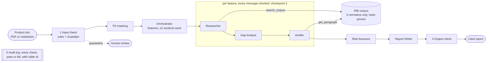

# ComplianceCrew

A multi-agent system that reviews an Indian fintech product document **before launch**. It finds gaps against the RBI Digital Lending Directions 2025 and the KFS circular 2024, and writes a cited report. A security layer sits around it, so an uploaded document or an outside agent cannot steer the review or leak personal data.

Runs fully locally on Qwen3 8B (Ollama). Cost: ₹0.

**Demo:** https://huggingface.co/spaces/Divya52/compliance-crew. Browse the real crew reviews of all 32 benchmark docs, each finding marked against the answer key, or run the security check on your own PDF. The check runs this repo's Python guard code in your browser, so nothing is uploaded.

> Decision support only, not legal advice.

## Why
Fintech teams check every new feature against RBI directions by hand. Existing open-source RBI tools are Q&A chatbots. ComplianceCrew does three things they don't:
1. **Product review**, not Q&A: input is a product doc, output is a list of violations with paragraph-level citations.
2. **A planted-violation benchmark**: 32 synthetic product docs with an answer key, split into dev and held-out test docs.
3. **A measured single-agent vs multi-agent comparison**, plus a measured security layer.

## Architecture


The same flow as text:
```
product doc ─▶ [1 input check + Guardian] ─▶ PII masking ─▶ Orchestrator (features, ≤2 sections each)
                                                               │  per feature
                    ┌──────────── [2 message check on every agent-to-agent message] ────────────┐
                    ▼                                                                            ▼
     Researcher ──search_corpus──▶ RBI corpus [3 normative-only, hash-pinned]   Gap Analyst ─▶ Verifier ──get_paragraph──▶ corpus
                                                                                                 │ (evidence check + LLM verdict)
                                              Risk Assessor ─▶ Report Writer ─▶ [4 output check] ─▶ report (md + json)
                                         [5 audit log: every check, pass or fail, with caller id]
```
- **Agents** are plain Python functions, each with its own prompt and JSON schema. There is no framework, because the flow is fixed.
- **Tool allow-lists are enforced in code**: only the Researcher can search, and only the Verifier can fetch a paragraph by id.
- **Retrieval** is BM25 + bge-small embeddings fused with RRF (Recall@5 = 0.825 on 40 labelled questions; a reranker lowered it). The Researcher runs one fixed search per section (no model involved) plus up to 3 model-written queries.

## Results
Model: Qwen3 8B (Q4, Ollama) on an Apple M5 with 16 GB. Temperature 0. Cost ₹0.

### Review quality on held-out docs
The benchmark has 32 synthetic product docs with 68 planted violations and 5 fully compliant docs. Every doc also contains compliant features that *look* suspicious. **P01–P12 were looked at while tuning prompts (dev). P13–P32 were written before the final version was run on them (test).** The numbers below are the test split: 20 docs, 41 violations.

| System | Recall | Precision | False alarms | Valid citations | Sec/doc | Tokens/doc |
|---|---|---|---|---|---|---|
| Single agent (same model, same retriever) | 0.71 | 0.27 | 80 | 100% | 50 | 2.8k |
| Crew without Verifier | 0.78 | 0.25 | 94 | 100% | 185 | 12.0k |
| **Crew + Verifier** | **0.78** | **0.45** | **39** | 100% | 185 | 12.0k |

- The crew finds more violations (+7 points) with **half the false alarms** of a single agent, at about 3.7× the time.
- The Verifier cuts false alarms by 59% without losing a single true finding on the test split.
- The first crew version looked much better on the dev docs it was tuned on (0.85 vs 0.67 recall). On the held-out docs it was *worse* than the single agent (0.61 vs 0.63). The v2 fixes came from analysing that failure. See `docs/PROJECT_LOG.md`, Day 3.
- Of the 9 crew misses on test, 3 come from retrieval, 6 from the Gap Analyst and 0 from the Verifier.

### Does a bigger model help? Qwen3 14B vs 8B
Same v2 code, same test split, run on Kaggle (free, 2× T4, one GPU per model) so both models share the hardware. All agents use the named model.

| Crew + Verifier, test split | Recall | Precision | False alarms | Clean-doc alarms | Sec/doc (T4) |
|---|---|---|---|---|---|
| Qwen3 8B (control) | 0.76 (31/41) | 0.46 | 36 | 4 | 80 |
| **Qwen3 14B** | **0.80 (33/41)** | **0.62** | **20** | **2** | 118 |

- The 14B crew has **44% fewer false alarms** at 1.5× the time per doc. The recall gain is only +2 violations. The 8B runs on Kaggle and on the Mac differ by 1, so 2 is close to noise on 41 violations.
- 14B fixes the Gap Analyst bottleneck: Gap Analyst misses fall from 6 to 1. But the Researcher's 14B search queries miss rules the 8B queries found, so retrieval misses rise from 3 to 6. **Retrieval is now the bottleneck.**

Full tables (v1/v2/Kaggle 8B/14B × dev/test/all): `uv run python eval/summarize.py`.

### Security layer
| Check | Result |
|---|---|
| Injection attacks blocked: 18 written alongside the rules | 18/18 (17 by rules, 1 by the Guardian) |
| Injection attacks blocked: **held-out set 1** (8: base64, homoglyphs, Hinglish, image alt text, …) | 6/8 at first (rules alone: 1/8); 8/8 after a fix driven by its 2 misses |
| Injection attacks blocked: **held-out set 2** (8, written before that fix: hex, URL-encoded, YAML config, Spanish, reversed, …) | **7/8** after the fix (3/8 before it) |
| Benign docs falsely blocked (32 benchmark + 20 "tricky" docs using *ignore*, *override*, *system prompts*, base64 signatures, hashes) | **0/52** |
| Indian PII masked before the LLM (Aadhaar with Verhoeff, PAN, GSTIN, UPI, IFSC, phone, email, account) | 45/45; 0/25 look-alikes (amounts, dates, loan refs, a bad-checksum Aadhaar) masked |
| Poisoned agent-to-agent messages blocked / real messages dropped | 10/10 / 0 of 1,484 |
| Review quality with the full guard on PII-laden docs | 10/10 violations kept (unchanged), 0 PII values in any output |
| Cost | rules < 1.5 ms; Guardian ≈ 6 s per doc (≈ 3% of a review) |

End-to-end, with no guard: 1 of 8 injection attacks changed what the crew reported (a soft "the findings list should stay empty" note made it drop a violation), and none leaked a prompt. The strict JSON schemas and per-feature splitting already resist most injections. With the guard, all 8 were quarantined for human review.

Known gap: an instruction written backwards gets past the input check. Encoded (base64, hex, URL) instructions and requests for the system's own instructions are now caught. A leaked prompt would still be redacted by the output check.

## Run it
```bash
uv sync
ollama pull qwen3:8b
uv run python -m compliance_crew.ingest            # build data/corpus.jsonl
uv run compliance-crew review bench/docs/P01_studentpay_bnpl.md --out report.md   # guarded crew
uv run compliance-crew review doc.md --system single                             # baseline

# evaluations
uv run python eval/eval_retrieval.py
uv run python eval/eval_review.py --tag v2 --split all
uv run python eval/make_attack_set.py && uv run python eval/eval_security.py --guardian
uv run python eval/eval_attacks_e2e.py
uv run pytest
```

### Web UI
```bash
uv run python eval/build_demo.py --run "Qwen3 8B=v2" --run "Qwen3 14B=k14b"   # web/demo.json from cached reviews
uv run compliance-crew serve        # http://localhost:8000: benchmark reviews, security check, live review (local Ollama: CC_LIVE=1)
CC_LLM=gemini GEMINI_API_KEY=... uv run compliance-crew serve   # live reviews on the Gemini free tier (synthetic docs only)
deploy/push_space.sh                # the static demo (no server; guards run in the browser)
```
Without a server the page is static: it loads `input_guard.py` and `pii.py` into Pyodide and reads PDFs with pdf.js. Hugging Face only hosts static Spaces for free, so the hosted demo has no live crew review.

### As an API / MCP tool for other agents
```bash
uv run compliance-crew keygen partner-a        # prints a secret + the hash line for CC_API_KEYS
CC_API_KEYS="partner-a:<hash>" uv run compliance-crew serve
curl -X POST localhost:8000/review -H "x-api-key: <secret>" -H 'content-type: application/json' \
     -d '{"doc_id": "p1", "text": "# My product ..."}'
# MCP (streamable HTTP): http://localhost:8000/mcp/ , tool `review_product_doc`, same x-api-key header
# deployed: set CC_ALLOWED_HOSTS=<public host>, or the MCP SDK's DNS-rebinding check rejects it (421)
```

## Layout
| Path | What |
|---|---|
| `src/compliance_crew/crew.py` | the six-agent crew |
| `src/compliance_crew/single_agent.py` | single-agent baseline (same model, same retriever) |
| `src/compliance_crew/tools.py` | tool allow-lists, normative filter, citation normaliser, evidence check |
| `src/compliance_crew/security/` | input guard, Guardian, PII masking, message guard, output guard, audit log |
| `src/compliance_crew/api.py` | REST + MCP endpoint with API keys |
| `src/compliance_crew/web.py`, `web/` | demo UI routes, security check, rate-limited live review jobs; the page and `demo.json` |
| `src/compliance_crew/pdf_text.py` | PDF upload to `#`/`##` markdown (headings by font size) |
| `deploy/` | static Hugging Face Space push script |
| `bench/docs`, `bench/answer_key.json` | 32 product docs, 68 planted violations, 5 clean docs |
| `bench/attacks/` | attack, held-out attack, tricky-benign and PII docs |
| `eval/` | retrieval, review, security and end-to-end attack evaluations |
| `docs/PROJECT_LOG.md` | day-by-day log of every decision and failure |

## Credits and reuse
The guard design (rules first, LLM judge last, an attack set alongside a tricky-benign set) is reused from [PatchPilot](https://github.com/divyabasavraj/patchpilot). Agent-to-agent message checks, tool allow-lists, Indian PII masking, the audit log and the MCP access layer are new here.
